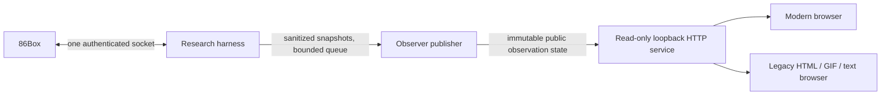

# Read-only browser observer: proposed architecture

Design only, 2026-11-04. No web server, browser dashboard, network exposure or
additional emulator client was implemented in this session. The normal visible
emulator window already works; this proposal complements it.

The harness is the **sole socket owner**. The observer process never reads the
token, opens a socket to 86Box, or controls the guest. It serves an explicitly
exported observational state rather than tailing private raw journals.

## Producer contract

At an explicit observation/milestone, the harness serializes native framebuffer,
approved status and optional approved memory/register reads through its existing
exclusive connection. After validating the held observation bracket, a publisher
exports a minimal immutable record to a separate observer service. It uses a
bounded queue or atomic snapshot replacement; a slow browser cannot block guest
control, create additional emulated time, release hold or cause command replay.
Throttling is in host time. Skipped publications increment a dropped-update count.

Suggested public fields:

- Session/observation IDs, monotonically increasing sequence and reset generation.
- Friendly machine label, emulated milliseconds, held/paused state, frame count,
  video mode and dimensions; wall observation time and explicit stale/error state.
- Current action from a safe vocabulary (`boot`, `step`, `key sequence`, `observe`),
  recent sanitized action summaries and authored experiment milestones.
- Last approved framebuffer plus its render generation/time. Label it as the
  latest rendered frame, which may predate CPU capture; do not imply instruction
  precision or silently advance the guest to refresh a frame.
- Optional CPU fields and named, bounded RAM views approved for the experiment.
  Default off; no arbitrary address entry or automatic raw-memory publication.

Do not export raw command lines or journal responses. They can contain typed
secrets, private media paths, UUIDs or guest data. Sanitization is an explicit
allowlist, not a blacklist of a few token names. A screenshot can itself contain
sensitive data; enable pixel publication only for an approved observation context.
No original media, executable, ROM, NVRAM or documentation download endpoint exists.

## Two presentation layers

The modern interface presents the latest native PNG, an action timeline, emulated
clock and held/paused indicators, with optional approved register/RAM panels.
Short polling or a read-only event stream updates exported state only. Show
connection loss, frozen hold and stale frames clearly. No controls are offered.

The antique interface uses simple HTML with headings, links, a GIF image and PRE
text. Avoid JavaScript, CSS layout, canvas, SVG, WebSockets and required cookies.
Provide `/legacy/`, `/frame.gif`, `/status.txt` and a manual Refresh link; automatic
refresh is optional and cannot be assumed in early Mosaic. Support HTTP/1.0-style
requests and explicit Content-Length. Generate a modest, palette-limited GIF from
the published raster outside the emulator connection; never run the guest for
conversion. Provide plain text for clients without useful image support.

## Service boundary and validation

Bind to loopback by default, validate Host/Origin where applicable, and avoid
permissive CORS. Map fixed GET routes to exported data; reject traversal and
unrecognized paths. No keyboard, mouse, reset, media, memory-write or arbitrary
file endpoints. No proxying requests into the automation socket. Access from
another machine is a separate reviewed deployment task with appropriate access
control, not a reason to bind this prototype to all interfaces.

Keep the export directory separate from machine/evidence directories. Do not
follow symlinks/reparse points into private data. Bound frame size, history,
publication rate and retained disk usage. Public export should contain no token
material, absolute host paths, original software bytes or unrestricted guest RAM.

Before live use, test with synthetic frames/status: stalled viewers and publisher
backpressure; reconnect/reset generation changes; stale frames; hostile paths and
HTML text; oversized data; token/path redaction; and zero mutation/clock progress
from browser polling. Compare modern and GIF/text views on the same observation.
Validate the legacy page on an actual intended browser/version before claiming
Mosaic compatibility. Remote access, authentication choices and retained screenshots
need separate scope decisions. Implement this as a later task after review of the
already published baseline and the small launcher follow-up.
