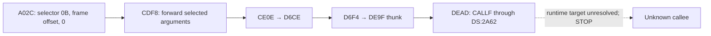

# Issue 22: one Calendar request and its dispatch boundary

2026-11-01. Started from public main75c637b for
[issue22](https://github.com/smartyhall/deskmate-formats/issues/22).
Offline, read-only investigation; no DeskMate execution or database mutation.

## Result

Calendar request **selector0x0B at file0xA02C** is a strong candidate for retrieving
the Description of the pre-existing internal row. Its argument construction
references Description and forms an equality predicate using the same three
Date bytes,20 20 FF, found in native E00 row ID10.

The instruction trace reaches **CALLF [DS:2A62] at0xDEAD** and stops there.
The stored slot contains unrelocated sentinel words ABCD,DCBA (offset then
segment), not a resolved
callee. Its runtime binding/export contract remains unknown. **No DMDBRD
routine or six-byte index consumer was reached or identified.**

The lookup purpose is a functional hypothesis, not a recovered API signature.
The evidence does not establish that selector0B is universally a reader or
exclude other side effects if it were executed. Nothing was executed here.

Confidence: **H** = original bytes/address arithmetic or verified instructions;
**M** = functional interpretation; **U** = unresolved.

## Scope and selection

The prior map's Calendar wrapperD684 has twelve near-call byte candidates,
all using selectors33/34 in their immediately preceding argument construction.
That path was rejected for this investigation. The thunk's other already
verified caller,D6F4, belongs to wrapperD6CE. Its direct callerCE0E forwards
arguments fromCDF8. A bounded caller query ofCDF8 exposed the selected request.

Selection stopped at the first branch with both a concrete selector and a
predicate matching existing native evidence. Only this Calendar request was
traced; no second application or other selector was pursued. The sibling
selector11hex in the same function is recorded as an excluded alternative.

## Exact corpus and evidence

All application offsets are absolute hexadecimal file offsets. They do not
depend on Ghidra's synthetic1000 load segment.

| Input | SHA-256 | Role |
|---|---|---|
| CALENDAR.PDM |819df5658b663aa69b15584abf805062679e97f587f3404738f6e82876e4bd23|Original application image from the preserved F00 before installation |
| E00 PERSONAL.CLN |c556b7f57102fc5432ce926317c8c0aa95cf8992d7fb64a72e2f270e4c517890|Native no-user-appointment fixture; pre-existing row retained |

Application source: DOSLAB EXPERIMENTS/FILER/F00_baseline/before/files/DESKMATE.
Native fixture: EXPERIMENTS/PHASE2/E00_default/files/DESKMATE/PERSONAL.CLN.
New private evidence: EXPERIMENTS/RESEARCH/lookup_trace_22. No host paths or
proprietary listings are published. The
[machine call map](database-call-map.json) contains the additive issue22 trace,
input identities, exact edges, argument observations and evidence hashes.

Existing Ghidra ApplicationReview was copied into a separate LookupReview
project. One headless, no-analysis, read-only query examined Calendar only:
at most16 callers with bounded instruction windows, plus the selected function
at9FCD. It completed with exit0. Original projects were not opened for writing.

The private LookupRequest.java and lookup_task.py reproduce the query and
original-byte checks. Existing tools/inspect_structure.py supplies MZ/relocation
facts. New private test_lookup_trace_22.py protects five groups of observations.
No new production tool or competing decoder was necessary.

## Request construction

The conditional application DS file baseEA70 follows the explicit relocated
DS-load evidence in the previous review. It is not derived from an MZ DS field.
The known Ghidra register-form8E display anomaly is accounted for using original
opcode semantics; listing operand order alone is not used as evidence of DS/ES
assignment. Stack offsets below are relative to the selected function's BP,
not absolute runtime addresses.

| Observation | File reference | Confidence |
|---|---|---|
| Selected function starts9FCD; nonzero byte argument selects this branch |9FF3–9FF7|H instructions; no source-level function name assigned |
| Field-name reference Description |9FE3–9FEB; literal10926–10931, DS:1EB6|H; projection interpretation M |
| Replace the Date predicate operator with ASCII equals |9FF9–9FFD writes DS:1F2A; original template at10996 is Date followed by greater-than and spaces|H |
| Source value20 20 FF followed by NUL; destination is predicate suffix |Arguments9FFE–A005; source10A90–10A93, destination1099B|H |
| NUL-search/copy helper called atA006 →E296 |E296–E2C7; REP string operations and supplied source/destination|H byte/control relationship; expected copied predicate assumes DF clear |
| Prepare selector0B, caller BP−14hex and zero as three near-call words |A021–A02C|H |
| On return, save AX and copy request word BP−8 to DS:66D0 |A032–A03A|H; status/record-ID meanings U |

Under the stated string-copy condition, the constructed predicate is ASCII
Date= followed by20 20 FF and NUL. Native E00 contains those Date bytes at
1002–1004 in its pre-existing row; its index entry1428–142D identifies
block4/offset0/ID10. This independently supports an **existing-row retrieval/search
interpretation (M)**. It does not prove that the query succeeds, establish a
general selector API or show any index read by the executable.

The eight observed request words starting at caller BP−14hex are:

| Relative word | Constructed value |
|---:|---|
|0|Word read from DS:7480 |
|1|7CDA |
|2|1 |
|3|Caller BP−16hex, where the Description offset is stored |
|4|1 |
|5|Caller BP−18hex, where the predicate offset is stored |
|6|0 initially; copied to DS:66D0 on return |
|7|0 |

These are raw dataflow observations, not a recovered C structure. In particular,
the handle, buffer, count and identifier roles of these words are not assigned
as confirmed semantics.

## Verified transport and first unresolved edge

| Edge / state | Exact evidence | Classification |
|---|---|---|
|A02C →CDF8|E8 relative target; Ghidra call reference and original bytes agree|H |
|Zero third word selects forwarding branch|CDFE compares word BP+8 with1; CE02 branches toCE08; pushes words BP+6/BP+4|H; other branch not followed |
|CE0E →D6CE|E8 relative target|H |
|Request transport|D6DF–D6EA stores selector/argument offset in DS:2A52/2A54; D6EB–D6F3 pushes0,0,DS,2A5A|H; no guessed cross-module structure |
|D6F4 →DE9F|Previously verified call site, independently rechecked|H |
|DEAD →memory-selected callee|CALLF through DS:2A62, stored file slot114D2–114D5|H instruction; target U |
|Stored slot|Little-endian wordsABCD,DCBA; segment word has no MZ relocation|H; no same-image pointer target assigned |
|Binding candidate|Existing D7E5 sequence supplies DMDB and slot2A62 to INT E0 using AX0206/020C|H instructions; actual binding/export selection U |

The supplied DS:2A5A object contains two MZ-relocated pointer values at
114CA/114CE, resolving toEA4C/EA5D. Those advertised callbacks contain explicit
DS-load sequences. Their existence does not establish that the unknown callee
invokes them. They were recorded as data relationships, not followed as an
executed continuation.

The original caller passes only a **word offset** for its stack-local request.
The thunk supplies a stack address via ES:BX and separately carries application
DS in its argument words. No assumption that DS equals SS, nor an invented
reader-side far-buffer address, is needed for this trace.

The prior DMDB.R89 and DMDBRD descriptor candidates remain downstream inventory,
not reached nodes of this request. Neither the DMDB name nor the sentinel can
substitute for an established binding edge. Following reader routines after this
point would violate the issue's stopping rule.

## Negative result and next discriminator

**Precisely documented blocker:** this bounded slice does not establish which
code address INT E0 places in Calendar's DS:2A62 slot for this request.
Therefore the actual entry into DMDB.R89/DMDBRD and consumption of six-byte
index entries remain unproved. Original-byte call scans alone are not treated
as instruction-boundary or API-semantic proof; Ghidra validated the selected
caller and existing exported evidence covers the transport helpers.

MZ relocation checks and the existing named-component/descriptor observations
do not supply that missing assignment. The loader's INT E0 handler was not
reconstructed in this slice. This is an evidential stopping point, not proof
that further static resolution is impossible.

The strongest next task is a bounded offline trace of **INT E0, AX0206 binding
for the DMDB name and this one slot**, including its export/callback choice.
A resolver-to-DMDB.R89 callback relationship would establish the missing edge;
a different target or forwarding layer would distinguish the alternative.
Stop again if the resolver's target cannot be established. Native execution is
not yet required and is not proposed as an implicit fallback.

Verification and preservation receipts are retained privately and summarized
in the pull request. No six-byte index decoding, allocator reconstruction,
second-application comparison or Filer native experiment was attempted.

Local validation:79 portable tests,112 private regressions and the original72
lab tests passed. Ruff, REUSE92/92, source/distribution privacy audits and
wheel/sdist packaging passed. All11342 watched files retained size, hash and
modification time; all125 inherited guards passed. The previously unreadable
Ghidra lock exception remains recorded. Production codecs, tools, dependencies
and CI configuration are unchanged.
