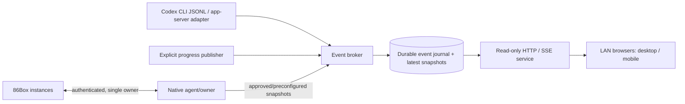

# DeskMate Observatory v2 — Functional Specification

**Status:** Proposed implementation specification, 2026-11-05  
**Target repository:** [`smartyhall/deskmate-formats`](https://github.com/smartyhall/deskmate-formats)  
**Priority:** Instrumentation and reliability first; visual redesign last  
**Target environment:** Dedicated Windows 10 research VM with 86Box native automation, Codex and Ghidra; ordinary browsers on the user's trusted LAN.
**Future platform exploration:** [Deferred headless research appliance roadmap](headless-research-appliance-roadmap.md); not a prerequisite for Windows acceptance.

The [M0/M1 implementation guide](observatory-v2-m0-m1.md) and
[M2 Codex CLI guide](observatory-v2-m2.md) record the shipped contracts,
operator workflows, and milestone decisions.

## 1. Purpose and decisions

Build a browser-based, **strictly read-only** operations console for agents conducting emulator experiments. The operator must be able to monitor emulator screens, host/guest state, agent progress, tool/test activity, pending approvals, and historical milestones from a different computer or phone **without RDP, keyboard/mouse capture, or any emulator-control surface**.

The existing observer is *already working*: `deskmate_formats.observer` serves a modern dashboard, classic HTML view, PNG/GIF, status API, and synthetic demo; the native MCP owner can publish approved observations. Its canary test measured zero guest-time advancement and zero new native connections during repeated browser requests. Preserve that property and its existing tests.

### Product decisions

1. **Local laboratory deployment is the primary product.** LAN viewing is a supported, intentional configuration. The user accepts full/verbose diagnostic visibility on a trusted network. Do not make PII-heavy institutional policy the default experience.
2. **Observation and control are permanently separated.** The browser server has no API for input, run/step/pause, reset, media mounting, arbitrary memory reads, process termination, or owner authorization changes. This applies equally on localhost and LAN.
3. **Browser requests never contact emulator automation.** They only consume already-published immutable snapshots/events. An owner-side independent schedule may publish samples if explicitly configured; its frequency never changes with the number of browsers.
4. **The agent feed is a first-class data source, not a string appended to the emulator's event timeline.** Multiple agents and emulators may have independent lifetimes and many-to-many associations.
5. **Observe only what can be known.** A live Codex process is not proof that reasoning is progressing; silence means *no new reported event*. A process/transport heartbeat is not an agent reasoning heartbeat.
6. **Build incrementally and preserve compatibility.** Keep the existing `/`, `/legacy/`, `/api/status`, `/status.txt`, `/frame.png`, `/frame.gif`, `/healthz`, `/i/<id>/...` routes, public schema, and synthetic tests unless a versioned migration is explicitly defined.
7. **Prioritize function, robustness and ergonomics.** Styling should stay usable and legible, but a full retro-themed redesign is a later milestone.

## 2. Existing architecture and constraints

At the time of design, important modules are:

- `src/deskmate_formats/observer/publication.py`: immutable machine observations, 1–8 machine streams, bounded in-memory status timeline and freshness.
- `src/deskmate_formats/observer/http.py`: GET/HEAD HTTP/1.0 server currently bound to `127.0.0.1`; resource routes, host validation, request bounds and worker cap.
- `src/deskmate_formats/observer/presentation.py`, `dashboard.js`, `dashboard.css`: modern/classic pages and rendering.
- `src/deskmate_formats/automation/observer_bridge.py`: native owner-to-observer publication.
- `src/deskmate_formats/automation/readonly.py`, `mcp_server.py`: single authenticated read-only owner and optional embedded listener.
- `src/deskmate_formats/observer/demo.py`: synthetic multi-station fixture.
- `docs/research/86box-observer-design.md`, `86box-readonly-mcp.md`, `86box-observatory-live-report.md`: current behavior, approvals and benchmark.

Today's native display approvals bind exact checkpoint hashes. In v2, separate **producer permissions** from **viewer visibility**. The observer may display every observation the authorized producer has supplied, including a verbose stream, without a per-browser/per-screen approval ceremony. This does **not** authorize unbounded emulator memory reads or a browser connection to the native control socket.

### Target architecture



**Do not** place the LAN listener in the same trust role as an emulator controller. The publisher/collector may run on the same VM, but the serving code should receive only immutable approved/preconfigured data through a narrow interface. A stronger process boundary can follow if useful, without rewriting the schemas.

## 3. Functional requirements

### F1. Agent lifecycle and activity (P0)

Support agents independent of emulators. At minimum display: agent identifier, source type, session/run/turn IDs where available, task title, project/branch, related emulator IDs, process PID/start time when applicable, current reported phase, last event, last event timestamp, last transport/process heartbeat, duration, outcome, and error state. Never present a guessed internal thought as a fact.

Normalized event types:

- `session.started`, `session.ended`
- `turn.started`, `turn.completed`, `turn.failed`, `turn.interrupted`
- `plan.updated`, `milestone.completed`
- `tool.started`, `tool.completed`, `tool.failed`
- `command.started`, `command.completed`
- `test.started`, `test.completed` with count/pass/fail/skip summaries
- `git.commit`, `git.branch`, `git.pr.opened`, `git.pr.updated`
- `experiment.checkpoint`, `experiment.sample`, `experiment.result`
- `approval.requested`, `approval.resolved` (view-only indication; no approval action in observer)
- `process.heartbeat`, `process.exited`, `source.disconnected`, `source.reconnected`, `source.error`
- `agent.note` (bounded, explicitly supplied message)

Each event has a schema version, source type, origin/run ID, per-origin sequence, UTC time, monotonic ordering where available, severity, human summary, structured optional details, correlation IDs, and a `visibility`/data-class designation. Treat upstream timestamps as data and assign an ingest sequence and host timestamp locally to create trustworthy order.

Store raw structured source events privately if configured; normalize a stable readable projection for the feed. Do not infer an `approval.requested` event from a generic pause unless the source states it.

### F2. Ingestion adapters (P0/P1)

Provide three adapters in descending order of initial priority:

**A. Explicit local event publishing (P0):** A simple CLI/library such as `deskmate-observer-event --agent codex-lab --type milestone.completed --summary 'DMCSR anchors matched'`, accepting JSON from stdin for richer data. It writes to a restricted, append-only local spool or a private collector endpoint; **never** to the read-only browser HTTP interface. An agent script, Codex tool, experiment harness, Git script, or test runner can use it without knowing the dashboard internals. Constrain input size, reject invalid event schema, avoid storing secrets by accident in command arguments (prefer stdin), and acknowledge ingestion errors.

**B. Codex CLI JSONL adapter (P1):** Support a future controlled Codex invocation using `codex exec --json`, whose documented event types include `thread.started`, `turn.started`, `turn.completed`, `turn.failed`, `item.*`, and `error`. Map command, file edit, MCP call, plan and agent-message items when the source provides them. Preserve parent-child item IDs and completion outcomes. Never require starting a *second* Codex run merely to attach telemetry to an existing one. Provide a wrapper that captures the JSONL while preserving the original exit code and stderr and recording process identity. If the existing invocation does not expose events, report `source_unavailable` and use explicit events/host process observation instead.

**C. Codex app-server and/or OpenTelemetry adapter (P2):** Investigate the documented app-server notifications (`turn/started`, `turn/completed`, `turn/plan/updated`, etc.) or local OTel logs. Connect only through supported APIs, version-check the source schema, and avoid claiming access to the internal state of an unrelated ChatGPT browser/desktop session. OTel export is opt-in and may have performance/privacy implications; if enabled, forward only selected metadata by default. These adapters are enhancements, not prerequisites for the useful P0 feed.

Official technical references:
- [Codex non-interactive JSONL](https://learn.chatgpt.com/docs/non-interactive-mode)
- [Codex app-server notifications](https://learn.chatgpt.com/docs/app-server)
- [Codex telemetry configuration](https://learn.chatgpt.com/docs/config-file/config-advanced)

### F3. Heartbeats, silence and fault classification (P0)

Use three distinct, labeled concepts:

- **Source process health:** process exists and matches the expected PID plus creation-time/executable identity, when the source is local and observable.
- **Collector health:** spool/adapter is receiving heartbeats or event transport is connected.
- **Agent reported activity:** last actual message, tool, plan or progress event.

Never collapse these into a single green “working” light. Suggested initial states: `active-reporting`, `alive-no-new-events`, `approval-needed`, `disconnected`, `finished`, `failed`, `unknown`.

Show elapsed time since last actual event and last transport heartbeat. Initial configurable warning thresholds: 2 minutes quiet, 10 minutes prolonged silence; these are display thresholds, not assertions of failure. For a process with no tool events for 20 minutes, say **“Process alive; no agent activity reported for 20 min”**, not **“Agent thinking”** unless explicitly reported.

When an agent process exits, fail to stopped/completed only if exit information supports it; do not leave it `running`. On collector restart, recover the last known run and mark it disconnected until reconnect or a new event.

### F4. Persistent timeline and replay (P0/P1)

Write normalized events into an append-only per-run JSONL journal **outside the Git repository**, with a separate bounded in-memory index/ring for quick delivery. Require a versioned envelope and restart recovery. A malformed/truncated final line is quarantined or safely skipped without losing earlier valid events. Support file rotation and retention by age and size; initial defaults can be 7 days and 100 MiB, configurable.

Support history since a monotonic server-assigned cursor, with stable ordering across page reloads, source reconnections and duplicate deliveries. Keep a machine snapshot (last frame, guest time, held/paused, generation, freshness), a distinct agent state snapshot, and a combined chronological operations feed. Allow filtering by machine, agent, run, event category and severity.

Avoid a heavy database requirement for the first milestones. A journal + bounded index is adequate; SQLite can follow if history/replay requirements outgrow it.

### F5. LAN read-only HTTP serving (P1)

Add a clearly named listener configuration, for example:

```toml
[observer]
listen = "192.168.88.169"       # example: configure actual VM NIC IPv4
port = 8086
visibility = "full"            # full | filtered
access = "trusted-lan"          # localhost | trusted-lan | authenticated
# trusted_subnets = ["192.168.88.0/24"]  # optional
```

Do **not** hardcode the sample address. Support `127.0.0.1` (existing default), one explicitly selected host NIC address, and optional all-interface binding with a conspicuous operational warning. Make interface binding separate from content visibility. Preserve original loopback route behavior and support valid LAN `Host` headers. Provide a Windows Firewall provisioning helper scoped to the executable, chosen port, profile and optional LAN source subnet. Avoid opening the 86Box native automation port.

For this trusted research lab, authentication can be **optional**. An authenticated mode should be available later for shared networks, with a straightforward read-only credential and compatible browser/image delivery. Never put the credential in query strings or logs. If HTTP Basic authentication is used, document its plaintext-over-HTTP limitations and recommend HTTPS for untrusted segments. Do not expose control simply because viewers are authenticated.

Security properties retained from v1: explicit GET/HEAD-only browser interface, bounded request sizes/timeouts/workers, no CORS grants, no arbitrary file serving, no sensitive local path discovery, escaped guest text, no cross-origin browser actions, and listener shutdown releasing the port. Read-only LAN is a convenience surface, not a privilege escalation path to RDP or the native emulator socket.

### F6. Browser/event APIs (P0/P1)

Preserve the existing routes. Add **versioned** read-only routes, with paths illustrative until implementation review:

- `GET /api/v1/agents` — list agent identities and summarized health.
- `GET /api/v1/agents/{id}` — agent/run status and current task.
- `GET /api/v1/events?after=<cursor>&limit=<n>` — bounded chronological events.
- `GET /api/v1/agents/{id}/events?after=<cursor>` — filtered agent events.
- `GET /api/v1/stations` — machine summary; complement existing per-machine `/api/status`.
- `GET /api/v1/stream` — optional Server-Sent Events for new publications; retained polling fallback.

Use a stable schema version, event IDs, UTC timestamps, source attribution, appropriate `Cache-Control`, and consistent `stale` semantics. Support reconnect using last-event ID or cursor and backfill from the journal. Browser refresh must **not** trigger a native sample, replay agent commands, or infer progress.

Keep read-only native data **producer-pushed**; if owners publish selected registers or approved/preconfigured bounded memory watches, include provenance, guest clock, address/module mapping and freshness so stale values are clearly marked. Never add an HTTP endpoint that accepts an arbitrary RAM address to read.

### F7. Function-first UI (P0/P1)

Initially improve the current dashboard minimally:

1. Top row: station selector, current guest state, current agent/task and last real activity.
2. Central panel: latest framebuffer, scale-to-fit while respecting aspect ratio; offer 1:1 pixels and fullscreen **view-only** display.
3. Agent activity feed: recent timestamped events, with counts, failures, ongoing commands, explicit `awaiting approval` if source reports it, elapsed silence, and last observed Git/PR activity.
4. Diagnostics below/alongside: guest time, hold/pause, freshness, most recent checkpoint, optional semantic dialog/focus state, source provenance.
5. History and inspector panels: expandable events with source ID, full detail as configured, copy-to-clipboard; no controls that mutate the guest.
6. Responsive layouts for mobile and desktop. On phones prioritize agent feed and a tap-to-enlarge guest framebuffer. Polling fallback when SSE is unsupported or interrupted.

The v1 classic HTML page stays functional and read-only; add agent last-activity text only after the data model is stable. Complete visual redesign (period-appropriate monitor frames, typography, color variants, animations) is not required for v2 functionality.

### F8. Multi-agent/multi-machine correlation (P1)

A job may involve several emulators or none; an emulator may be observed by multiple sequential agent runs. Assign stable IDs for machine, agent, run, experiment and checkpoint; use a correlation table rather than assuming one-to-one. Provide an overview of all active runs and machines and allow the user to filter down to a single workflow. Distinguish active agents from emulator status (a held guest is not proof the agent is idle).

### F9. Semantic DeskMate diagnostics (P2)

Ingest the offline decoder developed from the Calendar and DMCSR experiments via a **producer-supplied semantic snapshot**. Display `application`, `window_state` (`day`, `modal`, `unknown`), `dialog_candidate` with confidence/evidence, `focus_index`/mapped control, and known record/geometry measurements. Carry module/file hash, runtime base, checkpoint and validity. Never invent a dialog name from a six-byte allocation count alone. A failed code anchor or unmapped module must display `unknown` and withhold stale semantic interpretations.

This feature consumes read results already authorized to the emulator owner; it does not expand memory-access permissions from the HTTP side.

The [SDK-guided verification plan](sdk-semantic-observer-plan.md) separates app-owned forms, DMCSR allocation and event evidence into individually verified stages.
The [controlled Calendar replay](calendar-live-dialog-identity.md) verifies
Add, Change and Find Date identities from held, producer-supplied evidence
and demonstrates why a retained editor title must be ignored in day view.

### F10. Operations (P1)

Document installation, configuration, binding address, firewall scope, restart/recovery, log paths, backups, and clean shutdown. Provide a dedicated background supervisor/service that can run unattended under a normal lab user and recover the observer after a reboot **without** auto-starting or resetting emulators unless separately configured. Record supervisor PID/start time and child process identity; support safe, idempotent cleanup. Viewer disconnects never stop an experiment. Incompatible config should fail clearly rather than silently widening listening interfaces.

## 4. Concrete normalized event example

```json
{
  "schema_version": 1,
  "event_id": "local-000000004219",
  "ingested_at_utc": "2026-11-06T03:35:10.123Z",
  "source": "codex-cli-jsonl",
  "agent_id": "codex-win10-lab",
  "run_id": "dmcsr-geometry-20261106",
  "machine_ids": ["calendar-rsx-repeat"],
  "type": "experiment.checkpoint",
  "severity": "info",
  "summary": "Change Event geometry matched reference",
  "source_time_utc": null,
  "details": {
    "guest_ms": 31720,
    "checkpoint": "B-change-event",
    "code_anchors_verified": true
  }
}
```

This is a **fictional schema example**, not an assertion that the experiment produced those values. Ingested source content is bounded, escaped and never executed. Do not place passwords, private tokens, raw memory dumps or unreduced environment variables into an event's `summary` by default. A trusted operator may enable richer raw details in a separate private record.

## 5. Milestones, priorities, dependencies and acceptance gates

| Milestone | Priority | Deliverable / dependencies | Acceptance gate |
| --- | --- | --- | --- |
| **M0 — Contract and fixtures** | P0 | Versioned event schema, IDs/cursors, synthetic traces, explicit publisher, integration design. Independent of LAN. | Schema validation; deterministic replay; no native socket access from event ingestion. |
| **M1 — Agent feed MVP** | P0 | Durable append-only journal; events, job/agent panel; explicit CLI/library publisher; process/source/activity health separation. Requires M0. | Reboot/restart recovers history; silence accurately reported; event feed readable from localhost. |
| **M2 — Codex telemetry** | P1 | Codex CLI `--json` adapter, wrapper, test/command/plan mappings; app-server/OTel feasibility assessment. Requires M1. | Synthetic and captured-safe JSONL tests; run exit code preserved; no fake thinking events; current uninstrumented sessions explicitly unsupported. |
| **M3 — Trusted LAN viewer** | P1 | Interface binding, host validation, Windows Firewall helper, read-only API on LAN, multi-browser load/reconnection. Requires M1. | Actual second-device browser test; 200+ refreshes with zero guest-ms delta attributable to viewers and zero new native connections; no mutation routes. |
| **M4 — Correlation + recovery** | P1 | Multi-agent/machine mapping, history filter, session recovery, supervisor and graceful cleanup. Requires M1–M3. | Kill/restart collector and one viewer; no journal loss, duplicated actions, orphaned ports or guest impact. |
| **M5 — Semantic telemetry** | P2 | Ingest proven Calendar/DMCSR dialog/focus annotations and bounded watches from owner. Requires independent reverse-engineering validation. | Unknown/stale mappings are not mislabeled; matched offline A/B/C playback; browser traffic never expands RAM reads. |
| **M6 — Visual redesign** | P3 | Machine-centric layout, accessibility, classic theme and mobile polish, preference persistence. Requires stable functionality. | Usable on desktop and phone; keyboard/screen-reader basics; no regression in classic view. |
| **M7 — Optional restricted deployments** | P3 | Authentication, HTTPS guidance, source-subnet restriction and optional export formats. Does not block trusted LAN. | Authentication enforced on HTML, JSON and image routes; no token leakage; localhost/trusted configurations remain easy. |

**Suggested PR division:** M0+M1 (first PR), M2 (second PR), M3 (third PR), M4 (fourth PR), M5 (when reversing catches up), M6 and M7 independently. Avoid one giant redesign PR.

## 6. Required regression/integration tests

1. **HTTP isolation:** With a fake native socket recorder, hundreds of browser requests, refreshing while held and after disconnect, produce zero native `connect`, `read`, `step`, `key` or `reset` calls; unchanged emulated time and frame count. Distinguish independent owner-side polling, if enabled.
2. **LAN behavior:** Real HTTP client on a second LAN machine accesses the chosen NIC address; `127.0.0.1` remains local-only when configured; Host header validation works for LAN addresses; invalid hosts/CORS/origins rejected; no unadvertised bind to `0.0.0.0`.
3. **Multiple viewers:** At least five simultaneous readers of modern/classic/status/stream routes; one stalled client does not starve other viewers or the publisher; bounded workers, deadlines, responses and stream buffers.
4. **Event correctness:** Out-of-order, duplicate, malformed, oversized, partial and malicious JSONL; clock skew and reset; restart/replay consistency; cursor paging; concurrent publishers; stable IDs.
5. **Agent truthfulness:** Dead process, PID reuse, disconnected adapter, 15-minute quiet live process, outstanding approval, completed turn and failed turn produce distinct statuses without false progress.
6. **UI:** Frame aspect ratio, mobile view, filters, copy text and browser reconnect; escape HTML/JS from guest and agent strings. The browser never presents buttons to control emulators.
7. **Provenance and semantics:** Code-anchor mismatch, stale map, reused handle, unknown dialog count, Add/Change ambiguity, returned day view: unknown rather than overconfident semantic labels.
8. **Packaging:** Python wheel/sdist and Windows install tests; keep optional observer/Pillow and MCP dependencies; license checks, Ruff, project audit, no private fixtures or credentials.
9. **Real lab smoke test:** Hold a disposable guest, publish one approved framebuffer and three agent milestones; observe from phone/laptop on LAN; disconnect/reconnect browser; no guest-time advancement attributable to the viewer, no mouse/keyboard capture or console access.

## 7. Acceptance criteria for the first *useful* release (M0–M3)

An operator can leave Codex working on the Windows VM, disconnect RDP, and open `http://<VM-LAN-IP>:<configured-port>/` from a phone or laptop. The browser shows the latest emulator screen (if produced), current guest time/held status, agent task, last real event with elapsed time, process/collector health, recent commands/tests/milestones, and whether an approval is pending when the agent has emitted that fact. A page refresh or second viewer cannot change the guest or issue a native emulator command. Events survive an observer restart, and a quiet but live process is labeled honestly. Authentication can remain optional on the trusted lab LAN.

## 8. Explicit non-goals

- No browser keyboard/mouse input, file transfer into guests, stepping, reset, pause/unpause, or machine lifecycle control.
- No unaudited arbitrary RAM read endpoint, automatic RAM scanning, or broader authorizations than the native owner already has.
- No claim to read Codex's private internal thinking or access an uninstrumented remote-app session's invisible event stream.
- No need for a full polished retro UI, enterprise identity management, centralized multi-tenant SaaS, or mandatory TLS/authentication in the first trusted-LAN release.
- No automatic screen OCR as a requirement; native screenshots and explicit semantic data take precedence.

## 9. Initial implementation notes / sequence

- Build a separate `agent` data model and event broker rather than forcing agent events into `ObservationStream`, whose chronology is intentionally per-machine and screen-focused.
- Do not alter the MCP owner's `read_memory` guard or single-owner semantics to satisfy the browser.
- Keep the journal private and outside Git; synthetic trace generator and tests may be committed.
- Extend `http.py` with optional binding address and API routing while keeping all legacy behavior tested. If the request parser becomes too difficult to extend for SSE, factor a small HTTP routing layer rather than dropping its existing bounded-request protections.
- Publish semantics and agent progress by explicit side-channel events; the observer has no way to determine Codex thoughts during silent intervals.
- Validate the source of Codex events in the actual Windows environment before selecting an app-server vs CLI adapter. Existing Codex sessions cannot be assumed to be attachable to `codex exec --json`.
- Make shutdown/restart hygiene a first-class documented workflow: exact process creation time/PID, listener port, child/supervisor link, journal flush and no emulator shutdown on observer exit.

**Definition of success:** The operator no longer needs RDP or Codex's remote phone UI merely to learn *what happened most recently* or *whether an unattended experiment is still alive*, and monitoring cannot interfere with a held emulator.
